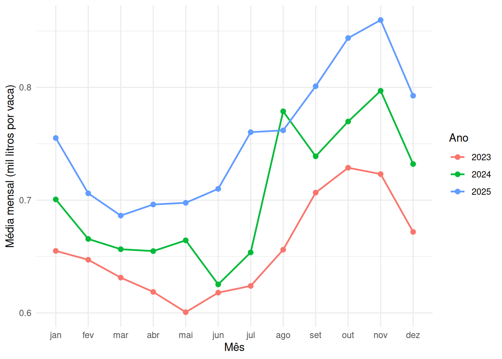
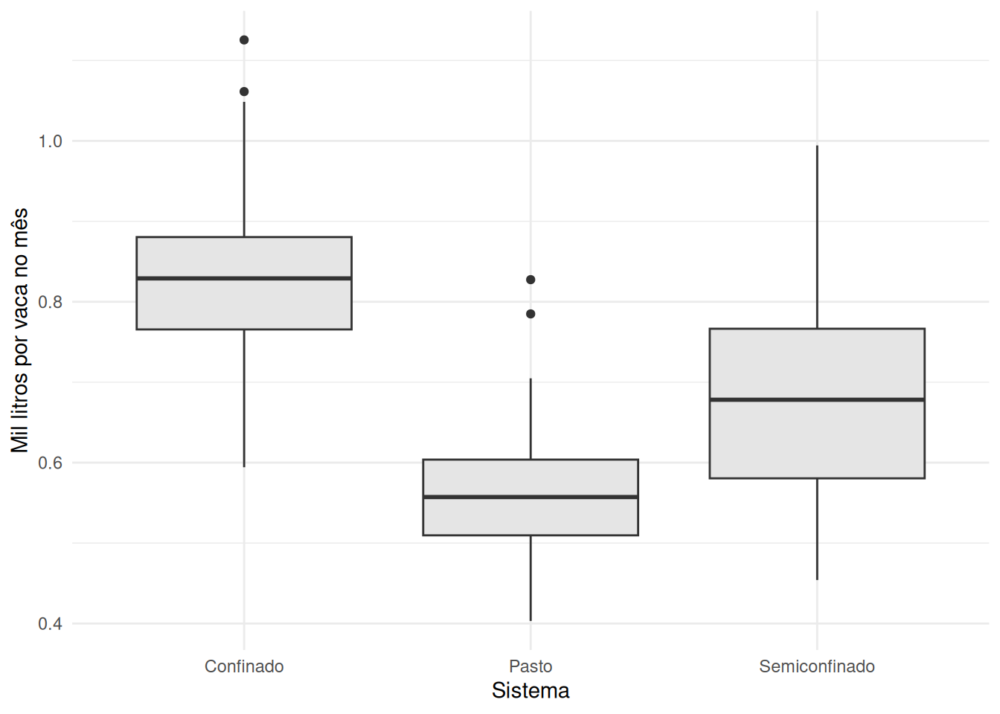

# Leite entregue pelas fazendas de uma cooperativa

``` r

library(leitecoop)
```

Esta vinheta refaz a análise do trabalho intermediário só com as funções
e os dados do pacote. As tabelas usam a função auxiliar abaixo, que
formata os números reais com duas casas decimais e vírgula decimal, por
meio da
[`formatar_numero()`](https://l4ur419.github.io/tdr-projeto/reference/formatar_numero.md)
do pacote.

``` r

tabela <- function(x, ...) {
  alinhamento <- ifelse(vapply(x, is.numeric, logical(1)), "r", "l")
  x[] <- lapply(x, function(coluna) {
    if (is.double(coluna)) formatar_numero(coluna, 2) else coluna
  })
  knitr::kable(x, align = alinhamento, ...)
}

# Nome por extenso de cada mês, para o texto
nome_mes <- c(
  jan = "janeiro", fev = "fevereiro", mar = "março", abr = "abril",
  mai = "maio", jun = "junho", jul = "julho", ago = "agosto",
  set = "setembro", out = "outubro", nov = "novembro", dez = "dezembro"
)
```

## Os dados

``` r

login <- ler_login()
cadastro <- ler_cadastro()
sem_medicao <- achar_sem_medicao(cadastro, ler_anuais())
conferencia <- summary(leite_fazendas)
```

Os dados são simulados, sorteados para o login `l4ur419` do GitHub, e
tratam do leite entregue pelas fazendas de uma cooperativa em 2023, 2024
e 2025. Os cinco arquivos brutos acompanham o pacote e são encontrados
pela
[`caminho_dados()`](https://l4ur419.github.io/tdr-projeto/reference/caminho_dados.md).
O cadastro, lido pela
[`ler_cadastro()`](https://l4ur419.github.io/tdr-projeto/reference/ler_cadastro.md),
tem 11 fazendas, das quais uma não tem medição em ano algum: Fazenda Boa
Esperança (código FZ01), encontrada pela
[`achar_sem_medicao()`](https://l4ur419.github.io/tdr-projeto/reference/achar_sem_medicao.md).

A tabela arrumada, com uma linha por fazenda, ano e mês, vem pronta no
conjunto `leite_fazendas`, montado pela
[`arrumar_dados()`](https://l4ur419.github.io/tdr-projeto/reference/arrumar_dados.md).
Ela é da classe `leitecoop`, cujo
[`print()`](https://rdrr.io/r/base/print.html) escreve uma linha de
resumo antes da tabela:

``` r

leite_fazendas
#> Leite de 10 fazendas em 3 anos (2023 a 2025), com 9 meses sem registro
#> # A tibble: 360 × 9
#>    origem           ano codigo mes   leite nome    sistema vacas litros_por_vaca
#>    <chr>          <int> <chr>  <fct> <dbl> <chr>   <chr>   <dbl>           <dbl>
#>  1 leite_2023.csv  2023 FZ02   jan    190. Fazend… Pasto     371           0.512
#>  2 leite_2023.csv  2023 FZ02   fev    182. Fazend… Pasto     371           0.490
#>  3 leite_2023.csv  2023 FZ02   mar    202  Fazend… Pasto     371           0.544
#>  4 leite_2023.csv  2023 FZ02   abr    168  Fazend… Pasto     371           0.453
#>  5 leite_2023.csv  2023 FZ02   mai    164. Fazend… Pasto     371           0.443
#>  6 leite_2023.csv  2023 FZ02   jun    198. Fazend… Pasto     371           0.535
#>  7 leite_2023.csv  2023 FZ02   jul    206. Fazend… Pasto     371           0.554
#>  8 leite_2023.csv  2023 FZ02   ago    226. Fazend… Pasto     371           0.609
#>  9 leite_2023.csv  2023 FZ02   set    220. Fazend… Pasto     371           0.592
#> 10 leite_2023.csv  2023 FZ02   out    224. Fazend… Pasto     371           0.602
#> # ℹ 350 more rows
```

A medida relativa usada nas comparações, `litros_por_vaca`, é o leite do
mês dividido pelo número de vacas da fazenda. Como o leite está
registrado em milhares de litros, a medida relativa está em mil litros
por vaca.

O [`summary()`](https://rdrr.io/r/base/summary.html) da tabela arrumada
é a conferência da leitura contra o `LEIA-ME.txt`
([Tabela 1](#tbl-conferencia)): em cada ano, o número de fazendas com
medição, as linhas da tabela (uma por fazenda e mês), os meses sem
registro e a soma dos valores registrados.

``` r

tabela(
  conferencia,
  col.names = c("Ano", "Fazendas", "Linhas", "Meses sem registro",
                "Soma (mil litros)")
)
```

|  Ano | Fazendas | Linhas | Meses sem registro | Soma (mil litros) |
|-----:|---------:|-------:|-------------------:|------------------:|
| 2023 |       10 |    120 |                  2 |         18.870,10 |
| 2024 |       10 |    120 |                  5 |         19.673,20 |
| 2025 |       10 |    120 |                  2 |         21.661,00 |

Tabela 1: Conferência da leitura, por ano: fazendas com medição, linhas
da tabela arrumada, meses sem registro e soma do leite registrado, em
mil litros.

**Meses sem registro.** Um mês sem registro foi tratado como dado
ausente, e não como produção zero: a falta de registro não indica que a
fazenda deixou de produzir. Por isso, ele continua `NA` na tabela
arrumada, e as somas e médias dos resumos ignoram esses meses. A decisão
afeta as colunas de total e de média da medida relativa, mas não afeta a
contagem de meses com registro, que apenas verifica se o mês foi
preenchido. Nos três anos há 9 meses sem registro, e o total registrado
é de 60.204,3 mil litros.

## Sazonalidade

O [`plot()`](https://rdrr.io/r/graphics/plot.default.html) da tabela
arrumada desenha a média mensal de mil litros por vaca em cada ano
([Figura 1](#fig-sazonal)).

``` r

plot(leite_fazendas)
```



Figura 1: Média mensal de mil litros por vaca, com uma linha para cada
ano.

``` r

por_mes <- resumir_mes(leite_fazendas)
maior_mes <- por_mes[which.max(por_mes$media_relativa), ]
menor_mes <- por_mes[which.min(por_mes$media_relativa), ]
```

Com os três anos juntos, pela
[`resumir_mes()`](https://l4ur419.github.io/tdr-projeto/reference/resumir_mes.md),
o mês de maior média é novembro, com 0,79 mil litros por vaca, e o de
menor média é junho, com 0,65 mil litros por vaca.

## Variação entre 2023 e 2025

``` r

resumo_anual <- resumir_ano(leite_fazendas)
primeiro <- resumo_anual[1, ]
ultimo <- resumo_anual[nrow(resumo_anual), ]
variacao <- 100 * (ultimo$media_relativa / primeiro$media_relativa - 1)
```

A [Tabela 2](#tbl-anual) resume cada ano, pela
[`resumir_ano()`](https://l4ur419.github.io/tdr-projeto/reference/resumir_ano.md).
A média mensal de mil litros por vaca passou de 0,66 em 2023 para 0,76
em 2025, uma variação de 15,0%.

A comparação usa a média da medida relativa, e não o total, porque o
total soma apenas os meses registrados: um ano com mais meses sem
registro teria total menor sem que a produção tivesse caído. O total
também depende do tamanho dos rebanhos. A média da medida relativa
considera só os meses registrados e desconta o porte de cada fazenda.

``` r

tabela(
  resumo_anual,
  col.names = c("Ano", "Fazendas", "Meses com registro",
                "Meses sem registro", "Total (mil litros)",
                "Mil litros por vaca")
)
```

| Ano | Fazendas | Meses com registro | Meses sem registro | Total (mil litros) | Mil litros por vaca |
|---:|---:|---:|---:|---:|---:|
| 2023 | 10 | 118 | 2 | 18.870,10 | 0,66 |
| 2024 | 10 | 115 | 5 | 19.673,20 | 0,70 |
| 2025 | 10 | 118 | 2 | 21.661,00 | 0,76 |

Tabela 2: Resumo por ano: fazendas com medição, meses com e sem
registro, total de leite, em mil litros, e média mensal da medida
relativa, em mil litros por vaca.

``` r

efeito_ano <- variacao_anual(ajustar_modelo(leite_fazendas))
```

O modelo `log(litros_por_vaca) ~ ano + mes + sistema`, ajustado pela
[`ajustar_modelo()`](https://l4ur419.github.io/tdr-projeto/reference/ajustar_modelo.md),
desconta o mês e o sistema de cada medição. Pela
[`variacao_anual()`](https://l4ur419.github.io/tdr-projeto/reference/variacao_anual.md),
a variação anual estimada é de 7,2% ao ano, com intervalo de confiança
de 95% de 5,7% a 8,8%.

## Diferenças entre categorias

``` r

resumo_categoria <- resumir_categoria(leite_fazendas)
maior_sistema <- resumo_categoria[which.max(resumo_categoria$media_relativa), ]
menor_sistema <- resumo_categoria[which.min(resumo_categoria$media_relativa), ]
```

A [Figura 2](#fig-categorias) mostra a distribuição de mil litros por
vaca em cada sistema de produção, e a [Tabela 3](#tbl-categoria) traz as
médias, pela
[`resumir_categoria()`](https://l4ur419.github.io/tdr-projeto/reference/resumir_categoria.md).
O sistema com a maior média é Confinado (0,83 mil litros por vaca), e o
de menor média é Pasto (0,56 mil litros por vaca).

``` r

grafico_categorias(leite_fazendas)
```



Figura 2: Distribuição de mil litros por vaca no mês, em cada sistema,
com os três anos juntos.

``` r

tabela(
  resumo_categoria,
  col.names = c("Sistema", "Fazendas", "Total (mil litros)",
                "Mil litros por vaca")
)
```

| Sistema       | Fazendas | Total (mil litros) | Mil litros por vaca |
|:--------------|---------:|-------------------:|--------------------:|
| Confinado     |        4 |          26.280,60 |                0,83 |
| Semiconfinado |        3 |          20.441,80 |                0,68 |
| Pasto         |        3 |          13.481,90 |                0,56 |

Tabela 3: Resumo por sistema, nos três anos: número de fazendas, total
de leite (mil litros) e média mensal de mil litros por vaca.
